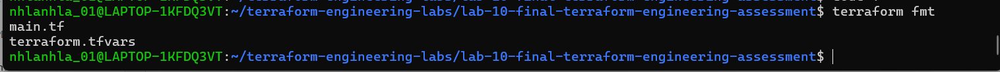
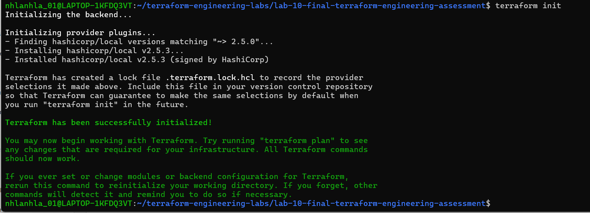
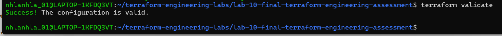
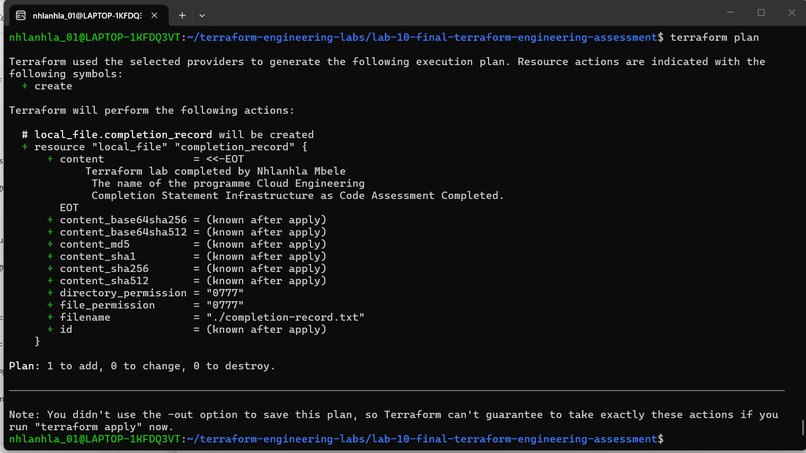
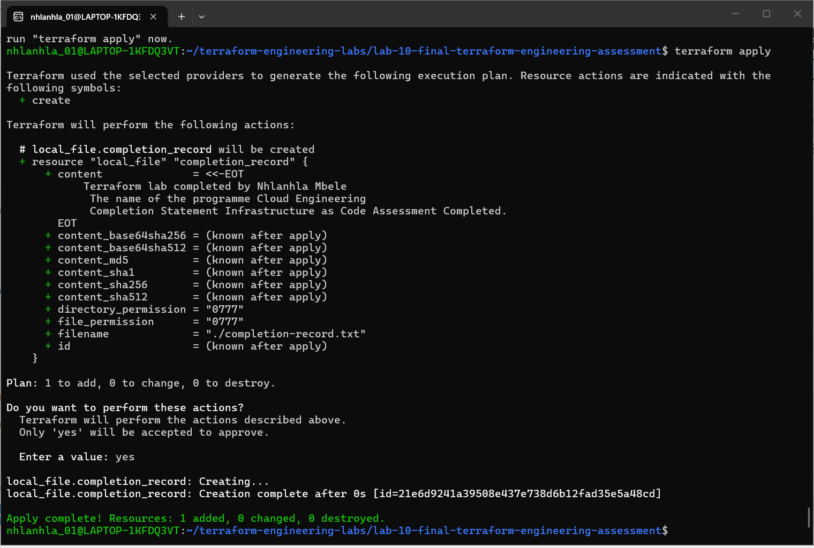
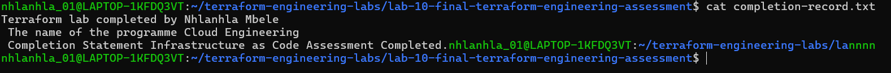

# Terraform Engineering Lab
## Purpose
- This Terraform project uses local provider to manage files on the learner’s computer.
- An AWS account is not required, and the exercises do not create AWS resources.
## Tools
- the local provider
- Git
- VS Code editor
## Configuration
- The main.tf purpose is to describe the infrastructure and use commands to validate whether the infrastructure is designed as intended or as it was planned. Variable files are used to declare other useful resources that can be used in the infrastructure, it makes the code reusable across various environments. main.tf and variables work together define and deploy infrastructure efficiently. 
## Execution
Commands used:
- terraform fmt

- terraform init

- terraform validate

- terraform plan

- terraform apply

## Verification
- The command was used to verify the results and contents of the file. 
- cat completion-record.txt

## Security
- The project uses .gitignore file to avoid publishing state files and exposing sensitive information. The file excludes state files from being tracked in version control because it may contain sensitive and confidential information.
## Lessons Learned
- Always verify your configuration if it working as intended. Use evidence to support. 
